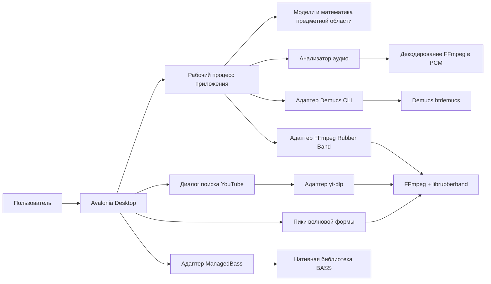
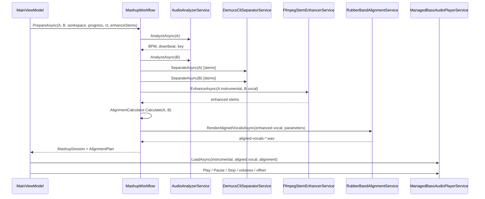

# Архитектура MusicMixer

## 1. Контекст

MusicMixer — кроссплатформенное десктопное приложение на Avalonia для создания мэшапа из двух локальных аудиофайлов. Оно разделяет стемы с помощью Demucs, рендерит изменения времени и высоты тона через FFmpeg + Rubber Band и воспроизводит через BASS. Приложение должно определять темп, даунбит и тональность, выравнивать вокал по сетке инструментала, корректировать его высоту тона и обеспечивать удобный синхронный предпросмотр. Тяжёлая работа никогда не должна блокировать UI Avalonia.

В этом документе описана реализованная архитектура. Поэтапный план поставки находится в [IMPLEMENTATION_PLAN.md](IMPLEMENTATION_PLAN.md).

---

## 2. Цели и ограничения

### Функциональные цели

1. Импорт двух локальных дорожек через выбор файла или перетаскивание.
2. Разделение дорожки A на инструментал, а дорожки B — на вокал.
3. Анализ BPM, первого даунбита 4/4 и тональности (нотация Кэмелота) для обеих дорожек.
4. Рендеринг вокала с изменением времени и высоты тона через FFmpeg/librubberband.
5. Предпросмотр обоих стемов синхронно, с независимыми регуляторами громкости и ручной подстройкой смещения ±5 с.
6. Возможность отмены всех длительных операций и понятные сообщения об ошибках.

### Архитектурные ограничения

- Avalonia UI со скомпилированными привязками и CommunityToolkit.Mvvm.
- Строгие nullable-ссылочные типы и предупреждения как ошибки.
- Слои в духе Clean Architecture.
- Отсутствие зависимостей от аудио и UI в Domain.
- Внешние инструменты — адаптеры за интерфейсами приложения.
- Поток UI не выполняет DSP и не ожидает внешние процессы.
- Продакшен-код предпочитает явные типизированные ошибки и ограниченную диагностику вместо широкого «поймать и продолжить».

### Не цели этого этапа

- Многодорожечная аранжировка/редактирование.
- Сохранение файла проекта.
- Сведение/экспорт без потерь и в форматы, отличные от WAV.
- Запись.
- Хостинг плагинов.
- Облачная обработка.

---

## 3. Системный контекст



UI общается со стабильными портами аудио и загрузки. Поведение, зависящее от инструментов, управление процессами и детали воспроизведения остаются в Infrastructure.

---

## 4. Слои

### MusicMixer.Domain

Чистая бизнес-модель и математика. Никаких зависимостей от файловой системы, процессов, медиа или UI.

Ключевые типы:

| Тип | Ответственность |
| --- | --- |
| `AudioTrack` | Неизменяемый путь к файлу, метаданные, длительность, BPM, смещение даунбита и тональность |
| `TrackMetadata` | Название/исполнитель/альбом; запасной вариант из имени файла |
| `StemSeparationResult` | Путь к источнику плюс пути к инструментальному и вокальному стемам |
| `AlignmentParameters` | Коэффициент скорости, сдвиг в полутонах, итоговое начальное смещение |
| `AlignmentPlan` | Автоматическое выравнивание плюс параметры рендеринга |
| `MusicalKey` | Тоника/лад, отображаемое имя и нотация Кэмелота |
| `AudioAnalysisResult` | BPM, даунбит, тональность и значения уверенности |
| `OperationProgress` | Прогресс 0..1 с ограничением диапазона и понятное пользователю сообщение |
| `AlignmentCalculator` | Детерминированная математика темпа, тональности и даунбита |
| `KeyTransposition` | Наименьший музыкальный сдвиг тональности с обработкой параллельных тональностей |
| Типизированные исключения | `AudioProcessingException`, `ToolUnavailableException` и т. д. |

### MusicMixer.Application

Оркестрация сценариев использования и порты. Слой не знает о Demucs, FFmpeg, BASS или Avalonia.

- `IMashupWorkflow`
- `MashupWorkflow`
- `MashupPreparationResult`
- `MashupSession`
- `AlignedVocalResult`
- Аудиопорты:
  - `IAudioAnalyzerService`
  - `IAudioSeparatorService`
  - `IAudioProcessingService`
  - `IAudioTrimmerService`
  - `IAudioWaveformService`
  - `IMixdownService`
  - `IAudioPlayerService`
- Порт загрузки:
  - `IYouTubeTrackService`
- DTO и исключения YouTube:
  - `YouTubeTrackItem`
  - `YouTubeServiceException`
- Порты хоста:
  - `IFilePickerService`
  - `IWorkspaceFactory` / `IWorkspace`

Рабочий процесс отображает прогресс дочерних операций в единый монотонный прогресс конвейера 0..1 и владеет порядком:

```
analyze A -> analyze B -> separate A -> separate B -> align -> render vocal
```

### MusicMixer.Infrastructure

Адаптеры и реализации движка:

| Компонент | Реализация |
| --- | --- |
| Запуск CLI | `ProcessRunner` с `ArgumentList`, без оболочки, отменой дерева процессов и ограниченным хвостом вывода |
| Разделение | `DemucsCliSeparatorService` |
| Анализ | `AudioAnalyzerService` + `FfmpegPcmDecoder` + управляемый DSP |
| Рендеринг времени/высоты тона | `RubberBandAlignmentService` |
| Обрезка источника | `FfmpegAudioTrimmerService` (выбор PCM WAV с точностью до сэмпла перед анализом) |
| Улучшение стемов | `FfmpegStemEnhancerService` (high-pass, EQ, компрессия и лимитер после разделения) |
| Волновая форма | `FfmpegWaveformService` (моно 8 кГц, оконные пики и нормировка без загрузки файла целиком) |
| Сведение микса | `FfmpegMixdownService` (FFmpeg `amix`, громкости и смещение вокала, WAV 48 кГц) |
| Загрузка с YouTube | `YtDlpTrackService` (`yt-dlp` + конвертация в WAV через FFmpeg) |
| Воспроизведение и прослушивание источника | `ManagedBassAudioPlayerService` |
| Временные файлы | `TemporaryWorkspaceFactory` |

### MusicMixer.Desktop

Представление Avalonia и корень композиции.

- `MainViewModel`: состояние, команды, обработка выбора/перетаскивания, назначение YouTube, локализованный прогресс/ошибки, обмен дорожек A/B, ручная скорость вокала и повторный рендеринг с задержкой, сохранение микса с необязательной обрезкой готовой дорожки.
- `TrackSlotViewModel`: неизменяемые метки дорожки и анализа для одной исходной дорожки; локализованный текст-заполнитель/статус.
- `YouTubeSearchViewModel` / `YouTubeResultViewModel`: поиск с задержкой, загрузка миниатюр, состояние назначения/загрузки и встроенный прогресс.
- `AudioAuditionViewModel`: воспроизведение перед добавлением, перемотка по таймлайну и состояние подтверждения/отмены.
- `AudioTrimViewModel`: прослушивание источника, выбор позиции/IN/OUT и проверенное состояние диапазона.
- `MainView.axaml`: основное рабочее пространство в духе shadcn со скомпилированными привязками, перематываемым транспортом мэшапа и целями перетаскивания.
- `MainWindow.axaml`: тонкая оболочка окна — владельца модальных окон.
- `YouTubeSearchDialog.axaml`: модальная поверхность поиска и назначения YouTube.
- `AudioAuditionDialog.axaml`: модальная поверхность прослушивания перед добавлением.
- `AudioTrimDialog.axaml`: модальная поверхность обрезки/прослушивания источника с волновой формой, учитывающей выделение.
- `Theme.axaml` / `AppStyles.axaml`: светлая/тёмная монохромные палитры, типографика и плоские стили элементов управления.
- `ThemeService` / `WindowThemeHelper`: системная/светлая/тёмная тема на лету и синхронизация нативной заголовочной панели. Системный режим отслеживает смену темы ОС.
- `ILocalizationService` / `LocalizationManager` / `LocalizeExtension`: мгновенное переключение RU/EN без пересоздания представления.
- `WaveformView`: пользовательский элемент управления для двух визуальных дорожек и общего курсора. Получает реальные массивы пиков из `IAudioWaveformService`; детерминированный макет используется только как пустое состояние до подготовки или при сбое декодера.
- `App.axaml.cs`: композиция Microsoft DI.
- `StorageProviderFilePickerService`: адаптер storage provider Avalonia.

Направление зависимостей:

```
Domain ← Application ← Infrastructure
                    ↖
                      Desktop
```

Проект Desktop — корень композиции, он ссылается на все слои. Ни один нижний слой не ссылается на Desktop.

---

## 5. Основной конвейер



Диапазоны прогресса задаются рабочим процессом:

| Этап | Доля |
| --- | ---: |
| Анализ A | 0–5 % |
| Анализ B | 5–10 % |
| Разделение A | 10–38 % |
| Разделение B | 38–66 % |
| Улучшение инструментала | 66–75 % |
| Улучшение вокала | 75–84 % |
| Рендеринг вокала | 84–99 % |
| Загрузка предпросмотра | финальный шаг |

Если улучшение отключено, зарезервированный диапазон пропускается и прогресс сразу переходит к рендерингу вокала. Рабочий процесс сообщает монотонный общий прогресс. Отдельные адаптеры приводят собственный «шумный» вывод инструментов к диапазону 0..1.

### Улучшение извлечённых стемов

После разделения `MashupWorkflow` при включённой настройке передаёт инструментал A и вокал B в `IAudioStemEnhancerService`. Реализация `FfmpegStemEnhancerService` применяет мягкий high-pass, EQ, компрессию и лимитер; для инструментала и вокала используются разные профили. Улучшенные файлы становятся основой сессии, поэтому предпросмотр и экспорт звучат одинаково.

---

## 6. Модель выравнивания

### 6.1 Темп

```text
tempoRatio = BPM(instrumental) / BPM(vocal)
```

Значение `1.10` означает, что вокал ускорен на 10 %, чтобы период его доли совпал с инструменталом. Коэффициент ограничен диапазоном `[0.5, 2.0]`, поскольку значения вне его почти всегда указывают на ошибку анализа в октаву. Рабочий процесс сообщает об этом как о явной ошибке выравнивания, а не исправляет молча.

### 6.2 Тональность

Вокал транспонируется на наименьшее знаковое расстояние от тоники, которое помещает его в тональность инструментала, с учётом двух музыкальных правил:

1. Тот же класс высоты тона → без сдвига.
2. Параллельные мажор/минор → без сдвига, поскольку они используют одни и те же ноты звукоряда.

Во всех остальных случаях используется интервал в `[-6, +5]` полутонов. Итоговый коэффициент высоты тона:

```text
pitchRatio = 2^(semitones / 12)
```

Точная подстройка добавляется к автоматическому сдвигу перед рендерингом. Это делает операцию идемпотентной: изменение ползунка точной высоты тона с +0.5 на +1.0 пересчитывается от исходной тональности, а не накапливает сдвиги.

### 6.3 Смещение даунбита

```text
automaticOffset = targetDownbeat - (sourceDownbeat * tempoRatio)
finalOffset     = automaticOffset + manualNudge
```

`StartOffset` определяется как **время начала вокала относительно начала инструментала**:

- положительное → вокал начинается позже,
- отрицательное → вокал начинается раньше (плеер пропускает соответствующую часть вокального вступления).

Анализатор сообщает фазу даунбита в пределах первого такта 4/4. Выравнивание этих фаз сделано намеренно: для предпросмотра мэшапа это полезнее, чем выравнивание произвольного сильного вступления во время длинного интро. Ручная подстройка ±5 с в UI применяется вокруг автоматического результата.

### 6.4 Команда рендеринга

```text
ffmpeg -hide_banner -nostdin -y
  -i vocal-stem.wav
  -map 0:a:0 -vn -sn -dn
  -af rubberband=tempo=<ratio>:pitch=<ratio>:transients=crisp:formant=preserved:pitchq=quality:channels=together
  -ar 48000 -ac 2 -c:a pcm_s16le
  -progress pipe:1 -nostats
  aligned-vocals-<guid>.wav
```

Замечания по проектированию:

- Форманты сохраняются, чтобы вокал с изменённой высотой тона не звучал неестественно тонко.
- Изменения времени и высоты тона происходят за один проход фильтра.
- Прогресс разбирается из машиночитаемого вывода `out_time_us`.
- Выход — PCM WAV, чтобы BASS мог открыть его без дополнительных кодековых плагинов.
- Аргументы процесса передаются через `ArgumentList`; нет поверхности для экранирования/инъекций через оболочку.

---

## 7. Реализация анализа

`AudioAnalyzerService` использует FFmpeg только для декодирования моно потока `f32le`. Весь анализ управляемый и выполняется внутри `Task.Run`, а не в потоке UI.

### Темп и даунбит

1. Декодировать первые 10 минут при 22.05 кГц, моно.
2. Кратковременное FFT (`1024`, шаг `256`) с окном Ханна.
3. Построить огибающую спектрального потока (spectral flux) плюс огибающую низкочастотного потока.
4. Вычислить нормированную автокорреляцию в настроенном диапазоне BPM (60–200).
5. Применить логнормальный приор 120 BPM и гармоническое усиление половинного/двойного темпа.
6. Уточнить выигрышную задержку параболической интерполяцией.
7. Выбрать фазу доли, чья сетка максимизирует энергию вступлений.
8. Выбрать позицию даунбита (0..3) с сильнейшими акцентами в низкой полосе.
9. Вернуть BPM, фазу/смещение даунбита 4/4 и оценку уверенности.

### Тональность

1. Кратковременное FFT (`4096`, шаг `4096`).
2. Свернуть спектральные бины от 65 Гц до 5 кГц в двенадцатибиновый вектор хромы с интерполяцией классов высоты тона.
3. Нормировать каждый кадр, чтобы громкие участки не доминировали.
4. Скоррелировать глобальный вектор хромы с мажорным/минорным профилями Крумхансл–Кесслера для всех двенадцати тоник.
5. Вернуть лучшую тональность, уверенность и отображение в Кэмелоте.

Этот анализатор делает ставку на отсутствие дополнительных зависимостей времени выполнения и детерминированное локальное поведение. Будущий адаптер `Essentia`/`librosa` может заменить его за `IAudioAnalyzerService`, не затрагивая рабочий процесс или UI.

---

## 8. Стабильное разделение

`DemucsCliSeparatorService`:

- создаёт уникальный корневой каталог вывода Demucs внутри предоставленной рабочей области;
- запускает `demucs --two-stems vocals --name <model> --out <root> <input>`;
- одновременно читает stdout и stderr, избегая взаимных блокировок;
- разбирает строки процентов tqdm, отображает фазы скачивания/разделения в монотонный прогресс и игнорирует повторяющиеся проценты;
- отменяет работу, убивая **дерево процессов**, затем ждёт завершения перед удалением частичного вывода;
- находит ровно один `vocals.wav` и один `no_vocals.wav`; отказывается от неоднозначного вывода;
- проверяет, что ни один стем не пуст;
- возвращает абсолютные пути в `StemSeparationResult`.

Весь stdout/stderr удерживается в ограниченном хвосте 32 КиБ для диагностики ошибок, а не в неограниченном журнале.

---

## 9. Проектирование воспроизведения

Воспроизведение намеренно отделено от конвейера рендеринга.

### Потоки и синхронизация

- Открываются два потока BASS: инструментальный стем и отрендеренный вокал.
- Инструментал является ведущими часами.
- В любой позиции таймлайна `t` желаемая позиция вокала:

```text
vocalPosition = t - startOffset
```

- Если это значение отрицательное, вокал остаётся на паузе, а монитор с шагом 20 мс запускает его, когда смещение истекает.
- Монитор ставит вокал на паузу, когда инструментал заканчивается.
- Пауза/остановка/перемотка сбрасывают монитор и синхронизируют оба потока от позиции ведущего.
- Изменение смещения во время воспроизведения немедленно выполняет повторную перемотку и перезапускает/приостанавливает вокал по необходимости.
- Громкости каналов — независимые атрибуты BASS.

### Ручная скорость и точная высота тона

`AlignmentCalculator` по умолчанию приводит темп вокала к темпу инструментала по BPM. В десктопном UI это значение показывается на ползунке «Скорость вокала» и может быть переопределено в диапазоне 0.5–2.0×; кнопки «Авто» и «1.0×» возвращают расчётное или нейтральное значение. Ручное значение передаётся в `RenderAlignedVocalAsync` как `playbackSpeedRatioOverride`, а автоматическое сохраняется в `AlignmentPlan.AutomaticPlaybackSpeedRatio`.

Изменения скорости и точной высоты тона требуют нового рендеринга Rubber Band. View-model применяет задержку 350 мс к изменениям ползунков, при необходимости приостанавливает воспроизведение, рендерит новый файл, атомарно подменяет потоки BASS, восстанавливает позицию и возобновляет воспроизведение. Предыдущий стем хранится до освобождения рабочей области; это делает неудачные загрузки восстановимыми.

### Обрезка готового микса

Кнопка «Обрезать и скачать» сначала сводит полный микс во временный WAV, затем открывает обычный диалог обрезки с прослушиванием уже готовой дорожки. После подтверждения диапазона пользователь выбирает путь, и `FfmpegAudioTrimmerService` сохраняет выбранный фрагмент. Временная рабочая область удаляется автоматически, поэтому отмена не оставляет файлов.

### Почему плеер никогда не растягивает время

Вынесение темпа/высоты тона из пути реального времени означает:

- предпросмотр и отрендеренный файл не могут расходиться,
- нет неожиданностей с качеством/CPU в реальном времени,
- нет дополнительной зависимости от FX-плагина,
- предсказуемое кроссплатформенное поведение.

Компромисс — короткий повторный рендеринг FFmpeg при изменении точной высоты тона. Эта операция отменяема и видна в UI.

---

## 10. Загрузка с YouTube

### Порты и поток

- `IYouTubeTrackService` предоставляет операции поиска и загрузки.
- На десктопе `YtDlpTrackService` запускает `yt-dlp` через `IProcessRunner`, а готовый аудиофайл конвертирует тем же FFmpeg, что и остальной конвейер. Для YouTube автоматически подбирается JavaScript runtime (Deno, Node.js или Bun), иначе современный `yt-dlp` не может пройти часть проверок.
- FFmpeg ищется в `MUSICMIXER_FFMPEG`, локальном каталоге приложения `tools/ffmpeg/bin`, каталоге приложения или `PATH`. `yt-dlp` ищется в `MUSICMIXER_YTDLP`, `tools/yt-dlp` рядом с приложением/репозиторием или `PATH`. Перед любой загрузкой медиа выполняется предварительная проверка `ffmpeg -version`.
- `YouTubeSearchViewModel` владеет текстом поиска, задержкой, отменой, загрузкой миниатюр, состоянием назначения и выбором пользовательского `cookies.txt` при ошибке входа.
- `YouTubeSearchDialog` — модальное представление; `IYouTubeDialogService` скрывает создание окна и обработку владельца от главной view-model.
- Скачанный WAV помещается в рабочую область YouTube для приложения, принадлежащую `MainViewModel`, поэтому его выбор не удаляет файл при замене рабочей области мэшапа.
- `MainViewModel` получает `YouTubeIngestionResult` с исходными метаданными поиска, локальным путём к WAV и целевой дорожкой, затем создаёт `AudioTrack` с реальными названием, исполнителем и длительностью.

### Поиск

1. Пользователь вводит текст или нажимает Enter.
2. Ввод запускает задержку 450 мс; Enter выполняется сразу.
3. Поиск отменяет предыдущее поколение и запускает `yt-dlp --flat-playlist --dump-json "ytsearch15:<query>"`.
4. Каждая NDJSON-строка разбирается в название, автора, длительность и URL самой большой миниатюры; служебные и битые строки пропускаются.
5. Миниатюры загружаются асинхронно через `HttpClient`; при ошибке используется типографическая заглушка.
6. У каждого результата две команды: назначить дорожке A или дорожке B. Обе отключены, пока идёт другая загрузка.

### Загрузка и конвертация

- Команда загрузки запускается только после выбора; идентификатор видео валидируется регулярным выражением до подстановки в URL.
- Адаптер скачивает лучший аудиопоток (`bestaudio/best`) с машиночитаемым шаблоном прогресса. Для обычных видео используется клиент `tv,web_safari`, который обходит proof-of-origin проверку веб-клиента.
- `yt-dlp` сообщает байты загрузки; прогресс масштабируется в диапазон 3–82 % общего импорта.
- Если YouTube требует вход (`SignInRequired`), адаптер автоматически повторяет загрузку с cookies браузера по умолчанию. При занятой базе Chromium загрузка завершается локализованным советом закрыть браузер; cookies можно задать и вручную через переменные окружения или кнопку «Выбрать cookies.txt» в диалоге YouTube, после чего неудачная загрузка повторяется автоматически.
- FFmpeg конвертирует скачанный контейнер в WAV PCM 48 кГц / стерео.
- Временные файлы удаляются всегда. Итоговый WAV публикуется атомарным перемещением, чтобы неудачная повторная попытка не уничтожила ранее созданный корректный файл.
- Диалог отображает активное название, этап и полосу прогресса прямо в окне.
- При успехе модальное окно закрывается с результатом назначения; иначе остаётся открытым с локализованной ошибкой и, для неожиданных сбоев, техническими подробностями. Результаты остаются доступными для повторной попытки, поскольку доступность на YouTube может меняться между запросами.
- Перед запросом загрузки адаптер проверяет, что FFmpeg может запуститься. Это позволяет не скачивать всё видео только для того, чтобы обнаружить невозможность конвертации.

### Доступность

На десктопе используется `yt-dlp`. Современный `yt-dlp` требует внешний JavaScript runtime для части проверок YouTube: `YtDlpTrackService` автоматически находит Deno, Node.js или Bun. Если YouTube требует вход, адаптер повторяет загрузку с cookies браузера по умолчанию; вручную их можно задать через `MUSICMIXER_YTDLP_COOKIES`, `MUSICMIXER_YTDLP_COOKIES_FROM_BROWSER` или `MUSICMIXER_YTDLP_JS_RUNTIME`. Ошибки классифицируются в `YouTubeFailureKind`, чтобы UI показал совет, а не технический текст.

---

## 11. Локализация во время работы и визуальная система

### Локализация

- `LocalizationManager` — синглтон, реализующий `ILocalizationService`.
- `Strings.en.json` и `Strings.ru.json` — ресурсы Avalonia с одинаковыми наборами ключей (213 ключей на момент написания).
- Менеджер владеет источником привязки `LocalizedString` для каждого ключа.
- `{loc:Localize Key=...}` возвращает одностороннюю привязку к `LocalizedString.Value`. `SetLanguage` вызывает `PropertyChanged` для каждого источника привязки, поэтому весь открытый XAML меняет язык без пересборки представления.
- Менеджер также предоставляет индексатор и вызывает стандартное уведомление индексатора для потребителей, которые предпочитают `{Binding [Key]}` расширению разметки.
- Статусы и тексты ошибок view-model хранятся как ключи локализации (плюс аргументы форматирования), поэтому смена языка обновляет активное состояние конвейера и карточки ошибок, а не только статические метки.
- Запуск следует `CultureInfo.CurrentUICulture` с откатом на английский.
- Элемент управления языком — сегментированный переключатель из двух кнопок в шапке.

### Система дизайна

- `Styles/Theme.axaml` — словарь токенов палитры и типографики со словарями тем `Light` и `Dark`.
- `Styles/AppStyles.axaml` — плоская система элементов управления.
- Визуальный язык адаптирован из shadcn/ui: нейтральные токены zinc, скруглённые поверхности, приглушённые вторичные области и сегментированные вкладки.
- Светлая: фон `#FAFAFA`, поверхности `#FFFFFF`, текст/действия `#09090B`, вторичный текст `#71717A`, границы `#E4E4E7`.
- Тёмная: фон `#09090B`, поверхности `#0E0E10`, текст/действия `#FAFAFA`, вторичный текст `#A1A1AA`, границы `#27272A`.
- Переключатель темы в шапке обновляет `Application.RequestedThemeVariant` без пересоздания представлений. По умолчанию используется `ThemeVariant.Default`, поэтому приложение следует теме ОС; ручной выбор Light/Dark сохраняется до конца сессии. Смена системной темы обновляет и DWM-заголовки открытых окон.
- Карточки используют радиус 10 px, элементы управления — 6–7 px, карточки получают лёгкую тень-подъём 1 px.
- Градиенты, свечения и стеклянные поверхности остаются исключены.
- Основные действия — сплошной цвет текста с инверсным текстом; вторичные — цвет поверхности с границей 1 px.
- `MainView.axaml` владеет рабочим пространством-панелью; `MainWindow.axaml` — только оболочка окна.
- Отдельный `YouTubeSearchDialog` следует той же системе, а не вводит собственный визуальный язык.

---

## 12. Потоки и жизненный цикл

| Работа | Поток |
| --- | --- |
| Состояние и команды UI | поток диспетчера Avalonia |
| Внешние процессы | асинхронный ввод-вывод, процесс выполняется в пуле потоков |
| DSP-анализ | рабочий поток `Task.Run` |
| Загрузка потоков BASS | пул потоков через `Task.Run` в адаптере плеера |
| Обратные вызовы прогресса | буферизуются и передаются в UI через `Progress<T>` |
| Монитор воспроизведения | фоновая задача с `PeriodicTimer` на 20 мс |

Правила:

- Никаких `.Result`, `.Wait()` или синхронного ожидания процесса в потоке UI.
- Состояние ViewModel изменяется только в потоке UI.
- Сервисы не хранят состояние, кроме инфраструктурных адаптеров с явными блокировками/временем жизни ресурсов.
- Подготовкой управляет единый связанный `CancellationTokenSource`; та же команда Cancel может отменить рендеринг точной высоты тона.
- Диалог YouTube владеет отменой поиска/загрузки и связывает её со временем жизни приложения; закрытие диалога отменяет частичное извлечение аудио.
- При завершении view-model останавливает воспроизведение, освобождает BASS, отменяет работу и освобождает временные рабочие области.
- DI-контейнер освобождает `IAudioPlayerService` и `IYouTubeTrackService` после view-model.

`AsyncRelayCommand` предотвращает повторный вход команды Prepare. View-model также защищается через `IsBusy` и обновляет доступность команд при изменении готовности, воспроизведения или состояния занятости.

---

## 13. Ошибки и отмена

Типизированные исключения — часть контракта Domain:

- `ToolUnavailableException` — отсутствует исполняемый файл или нативная библиотека.
- `AudioAnalysisException` — сбой декодирования/анализа или отсутствие тонального/ритмического содержимого.
- `AudioProcessingException` — сбой обработки CLI/нативного кода; несёт ограниченный диагностический хвост.
- `AlignmentException` — значения анализа не позволяют безопасно выполнить выравнивание.
- `OperationCanceledException` — ожидаемый путь отмены, а не баннер ошибки.

View-model отображает известные исключения в понятный текст UI. Ошибки инструментов включают инструкции по установке и, где доступно, хвост вывода процесса. Отмена не показывается как ошибка.

Адаптеры обязаны:

- никогда не проглатывать ошибки молча,
- очищать частичные результаты при сбое,
- сохранять исходное исключение как внутреннее,
- не раскрывать неограниченные журналы,
- не сообщать об успехе, если не существует непустого выходного файла.

---

## 14. Защита внешних процессов и файловой системы

- Везде используется `ProcessStartInfo.ArgumentList`; интерполяции командной строки нет.
- `UseShellExecute = false`.
- stderr и stdout всегда читаются одновременно.
- дочерние процессы убиваются целым деревом при отмене.
- обратные вызовы процесса получают данные, декодированные в UTF-8.
- каталоги временных заданий уникальны, а `IWorkspace.GetPath` проверяет их на обход путей.
- пользовательские файлы рассматриваются как входные данные только для чтения.
- выходные пути никогда не перезаписывают входной стем.
- удаление рабочей области выполняется по возможности после освобождения нативных дескрипторов плеером.
- для вывода предпросмотра обязателен `.wav`, чтобы дополнительные кодовые плагины BASS не требовались.

---

## 15. Стратегия тестирования

Текущее автоматическое покрытие:

- математика выравнивания (темп, сдвиг тональности, смещение даунбита, подстройка),
- валидация параметров,
- нотация Кэмелота и обработка параллельных тональностей,
- точное обнаружение стемов Demucs через подставной исполнитель процессов,
- монотонность прогресса,
- корректность пика FFT,
- обнаружение синтетического клик-трека 120 BPM с проверками даунбита,
- порядок этапов рабочего процесса, прогресс и оркестрация повторного рендеринга при точной подстройке с подставными объектами,
- разбор NDJSON-поиска, прогресса загрузки и классификация ошибок `yt-dlp`,
- повторная загрузка с cookies браузера после проверки «Sign in to confirm you're not a bot»,
- выбор пользовательского `cookies.txt` и его передача в `yt-dlp`,
- свёртка оконных пиков волновой формы, нормировка и граничные случаи.

Тестовый проект имеет доступ `InternalsVisibleTo` исключительно для примитивов DSP.

Ручная проверка во время этого этапа охватывала:

- мгновенное переключение RU/EN, включая заголовок окна, статус view-model и текст статуса дорожки,
- результаты поиска YouTube, загрузку удалённых миниатюр и зависящие от локали действия в строках,
- загрузку аудио с YouTube, конвертацию в WAV через FFmpeg и назначение дорожке A,
- локализованную встроенную ошибку при сбое конвертации FFmpeg.

Запланированные интеграционные тесты (см. план реализации):

- тесты точности анализа на реальных медиафайлах,
- дымовой тест рендеринга FFmpeg, включаемый только при наличии инструмента,
- тесты команд/состояния ViewModel с использованием headless Avalonia,
- паритет ключей локализации в CI,
- тесты API и загрузки YouTube за включаемыми переменными окружения,
- тесты воспроизведения BASS, изолированные за подставным плеером.

---

## 16. Развёртывание

- Цель: .NET 8 для десктопа.
- Avalonia 11.3.22.
- `yt-dlp` для поиска и загрузки YouTube на десктопе; FFmpeg конвертирует результат в WAV.
- Для YouTube на десктопе рекомендуется Node.js 22+ или Deno 2.3+; runtime находится автоматически или задаётся `MUSICMIXER_YTDLP_JS_RUNTIME`.
- ManagedBass 4.0.1 — управляемая обёртка; нативный BASS должен поставляться отдельно в соответствии с его лицензией.
- FFmpeg и yt-dlp могут поставляться локально в `tools/` и копироваться при публикации; Demucs остаётся внешним предварительным требованием.
- Windows/macOS/Linux используют нативное оформление окон платформы; светлая/тёмная палитра реализована внутри клиентской области.
- Переменные окружения позволяют задавать абсолютные пути к инструментам без экрана настроек.
- Автономная работа: вся обработка локальна, кроме загрузки модели Demucs при первом запуске и поиска/загрузки с YouTube по запросу пользователя.

---

## 17. Ключевые решения и компромиссы

| Решение | Обоснование | Цена |
| --- | --- | --- |
| Отделить математику Domain от сервисов | Детерминированное, покрытое юнит-тестами выравнивание | Немного больше типов |
| Встроенный анализ на C# | Нет зависимости от Python/librosa для темпа/тональности | Эвристическая точность, ответственность за DSP-код |
| Demucs CLI | Лучшее доступное локальное качество стемов; устанавливается независимо | Большая внешняя зависимость и загрузка модели |
| FFmpeg Rubber Band | Высокое качество растяжения времени и сохранения формант | Нужна специальная сборка FFmpeg |
| BASS для предпросмотра | Кроссплатформенное микширование двух потоков с громкостью/смещением | Нативный бинарник и лицензия |
| Рендерить высоту тона/время до воспроизведения | Предпросмотр равен экспорту; простой плеер | Задержка повторного рендеринга при правке точной высоты тона |
| Предположение о даунбите 4/4 | Соответствует целевому жанру мэшапа и упрощает UX | Нечётные размеры требуют ручной настройки |
| Живая локализация на основе JSON | Без генерации кода, без перезапуска, легко проверять перевод | Написание ключей не проверяется на этапе компиляции |
| Динамические источники привязки `LocalizedString` | Надёжные обновления во всех элементах управления и view-model | Один небольшой объект на ключ |
| Монохромная система с системной/светлой/тёмной темой | Сильная, последовательная идентичность продукта и следование настройкам ОС | Больше токенов и проверок контраста |
| YouTube через yt-dlp | Надёжный поиск/загрузка без ключа API и без привязки к одному NuGet-пакету | Нужен внешний бинарник и его обновление; cookies могут потребоваться при проверке YouTube |
| Реальные пики волновой формы | Таймлайн и редактор обрезки отражают фактический звук | Дополнительное декодирование файла; при сбое показывается нейтральный макет |

---

## 18. Точки расширения

- Добавить ручное переопределение BPM/тональности/даунбита в `AudioTrack`/`AlignmentPlan` и вывести поля в UI.
- Добавить экспорт в MP3/FLAC поверх существующего `IMixdownService`.
- Заменить `AudioAnalyzerService` адаптером Essentia/librosa без изменения рабочего процесса.
- Добавить сохранение проекта (JSON) с привязкой к путям рабочей области/стемов.
- Добавить выбор стемов (барабаны, бас, другое), расширив Demucs до четырёх стемов.
- Добавить планирование с точностью до сэмпла через микшер/API синхронизации BASS, если измерения покажут дрейф двух потоков.
- Добавить UI настроек для путей к инструментам, диапазона анализа, модели, устройства и аудиовыхода.
- Добавить упаковку, которая проверяет зависимости при запуске и ведёт пользователя через установку.
- Добавить альтернативную реализацию `IYouTubeTrackService` для собственной настройки YouTube Data API/OAuth или локальной установки `yt-dlp`.
- Добавить проверки CI на паритет ключей JSON и отсутствующие ключи `{loc:Localize}`.
